1. Instalación de CUPS (Servidor)

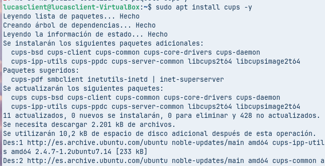

Habilitarem i arrancarem el servei.

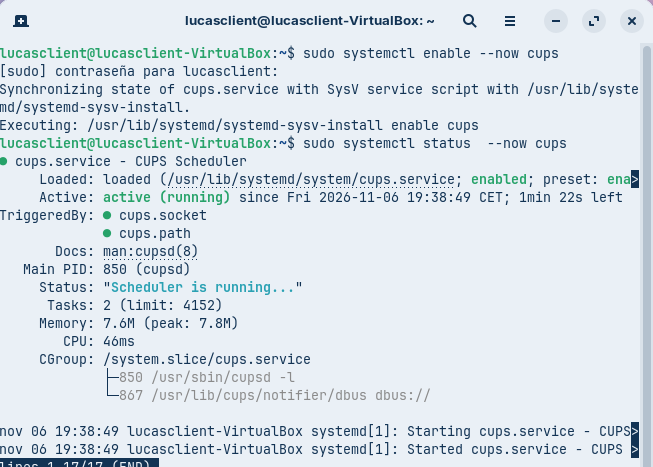

2. Instalación de la impressora virtual (cups-pdf)

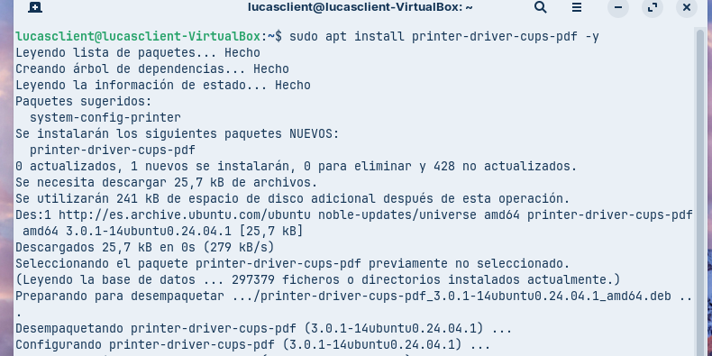

3. Configuración de l'administració de CUPS

Edició de l'arxiu de configuració:

Reiniciar el servei per aplicar els canvis:
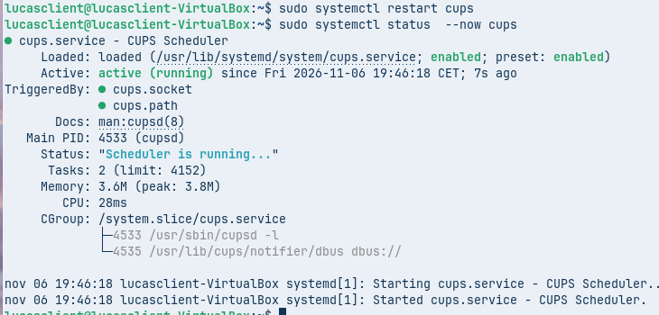

4. Compartición de la impressora (Interfície web)

Accés a l'interfície web:
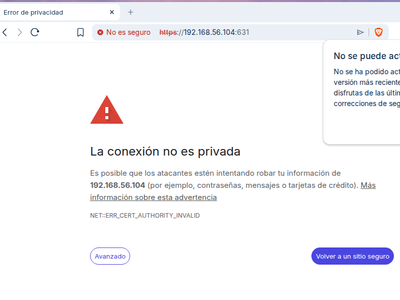

Ignorem lo de conexió privada i entrem a la web:
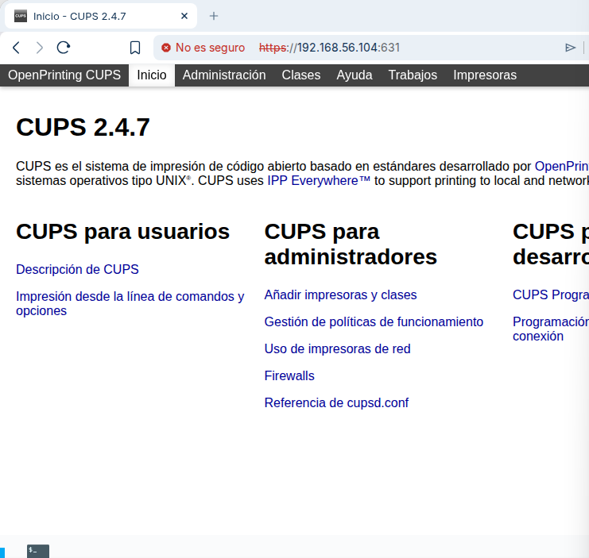

A la pàgina administració marquem les caselles de "compartir impresoras conectadas a este sistema" i "permitir administración remota".
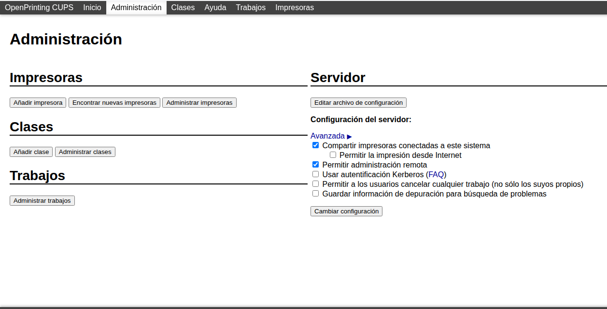

Entrem a l' apartat impressores i fem:

Avança pels passos mantenint la configuració actual fins a la pantalla de dades bàsiques i assegura't que la (Compartir aquesta impressora) està activada.
Guardem canvis:
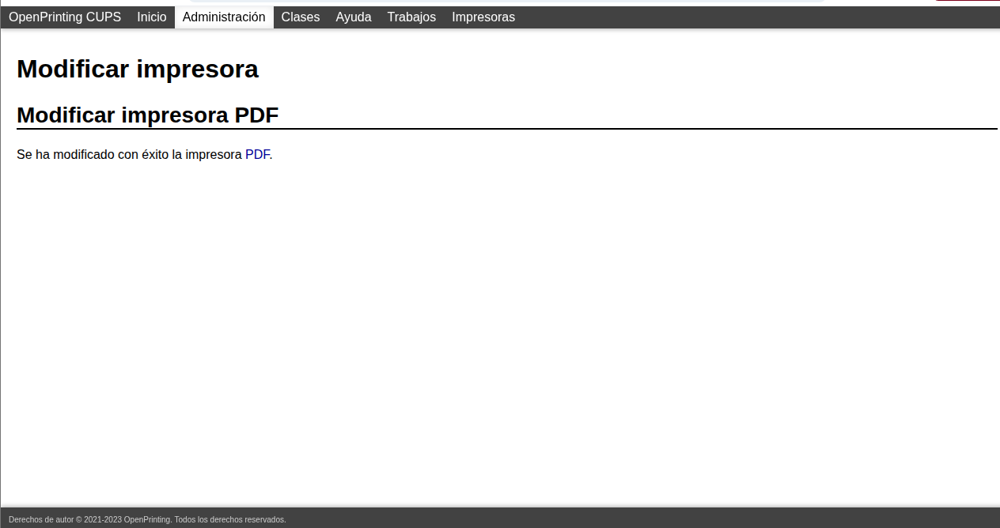

5. Configuració del client Zorin OS

Entrem a configuració --> impressores i a dalt de la pestanya i cliquem afegir impressora i afegirem la que hem configurat de cups:
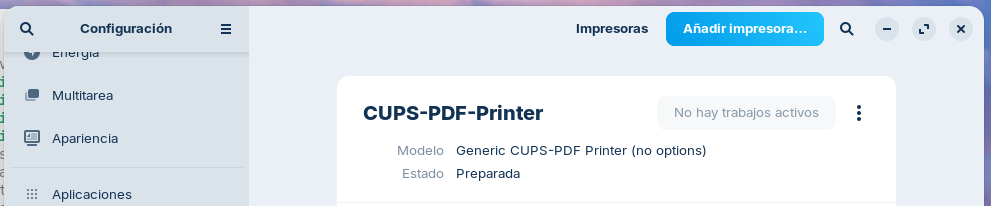

6. Proves d'impressió

Crearem un fixter .txt on posarem:
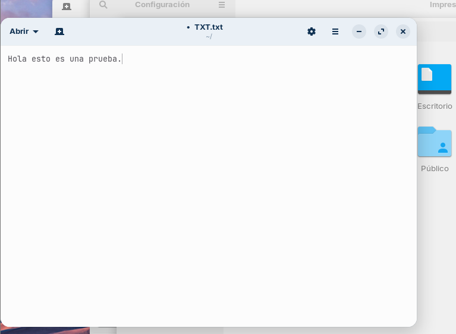

Impressió feta:
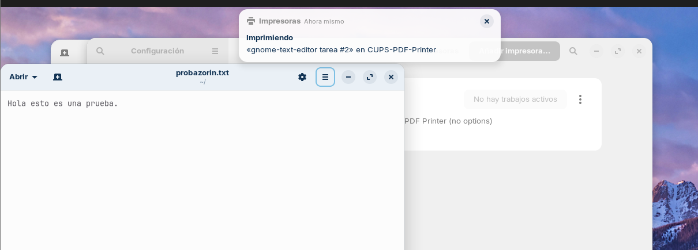

7. Comprovació dels documents generats

Llista de fitxers generats:
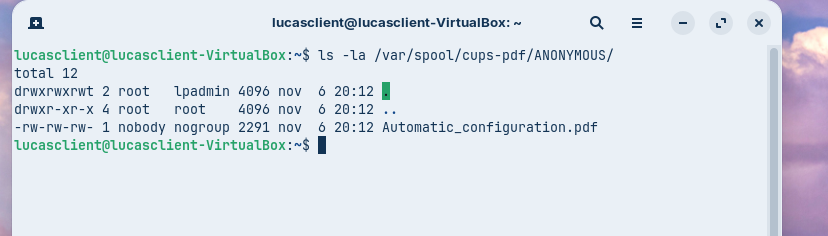

